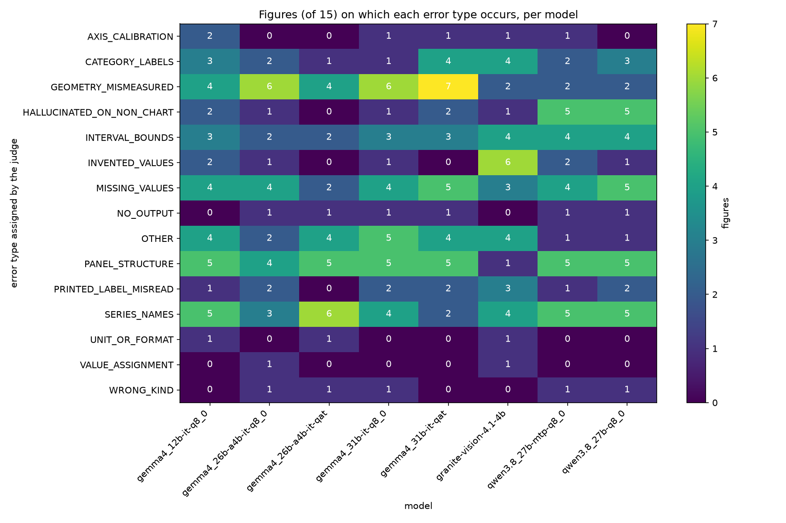
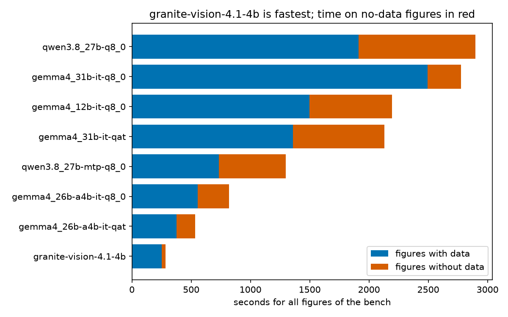
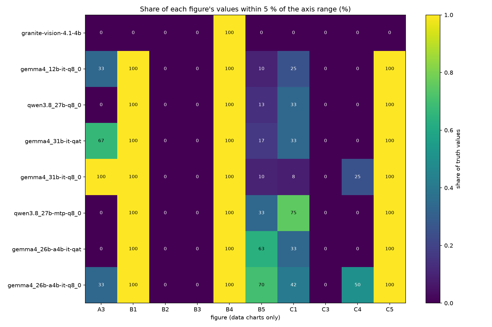

# Chart-to-data mini bench

Which local vision model should read the numbers behind chart figures, and
is any of them good enough to publish those numbers in a bundle?

Run on 2026-11-17 on 15 figures from 11 papers, with 8 models, against a
reference truth made by a frontier model and a judge pass that classifies how
each model was wrong. Everything needed to check or repeat it is in this
folder, except the figures themselves (see [Figures](#figures)).

## Answer

No model is good enough to publish chart numbers unreviewed. The best one
gets 4 of the 10 data charts into a state a downstream extraction could use
as is, and one of those four is read without any model at all.

| | usable data charts (of 10) | figures that would mislead | no-data figures left alone (of 5) | time for the 15 figures | GPU memory |
|---|---|---|---|---|---|
| Gemma 4 31B, 8-bit | **4** | 2 | 4 | 2,776 s | 37 GB |
| Gemma 4 26B-A4B, 8-bit | 3 | 4 | 4 | 819 s | 28 GB |
| Gemma 4 26B-A4B, 4-bit (QAT) | 3 | 4 | 5 ¹ | **535 s** | 16 GB |
| Gemma 4 31B, 4-bit (QAT) | 3 | 2 | 3 | 2,130 s | 22 GB |
| Gemma 4 12B, 8-bit | 3 | 5 | 3 | 2,195 s | 14 GB |
| Qwen 3.8 27B, MTP build | 2 | 7 | 0 | 1,297 s | 29 GB |
| Qwen 3.8 27B | 2 | 6 | 0 | 2,897 s | 29 GB |
| Granite-Vision 4.1-4B (chart-to-CSV) | 1 | 8 | 4 ² | 285 s | 8 GB |

"Usable" and "would mislead" (severity 3) are the judge's verdicts.
¹ One of the five (the ECG figure) was not read at all: the call ran past the
engine's 120 s budget. ² Three of the four are CSV that failed to parse, not
abstentions.

**If one model has to be chosen now: Gemma 4 26B-A4B, 4-bit (QAT).** It is
within one figure of the best on accuracy, five times faster than the 31B,
needs 16 GB, and is the only model the judge never marked for inventing
data, on charts or on non-charts. Choose
the 31B 8-bit instead when accuracy matters more than an extra half hour per
15 figures.

**The bigger lever is the engine, not the model.** Every model run through
our engine fails in the same three ways (see [How they fail](#how-they-fail)):
panels merged or lost on multi-panel figures, bar heights measured inside the
bar instead of at its top, and figures that hold no data being sent to the
model at all. Fixing those would lift every model.

## What was tested

**Figures.** 15 figures of the papers under `samples/aca-papers`
([`FIGURES.md`](FIGURES.md), [`testset.json`](testset.json)):

- A1-A5: all five figures of one paper (Cardiologent) that the figure typer
  passes as chart candidates. One is a data chart; four are diagrams or ECG
  traces. This part measures the real cost of turning the feature on for a
  paper.
- B1-B5 and C1-C5: picked as data charts of different kinds from ten other
  papers (grouped bars with printed counts, line panels, ROC panels, forest
  plot, box plots, bar panels, stacked rating bars, vector pies). One of
  them (C2, typed "heatmap" with confidence 1.00) turned out to be a
  schematic.

So: 10 data charts with 560 truth values in 33 panels, and 5 figures without
data.

**Models** ([`config.json`](config.json) has tags, digests and options):

- Seven Ollama vision models, each run through this fork's figure-to-data
  engine in `measured` mode (`amir-figdata run`): Gemma 4 12B, 26B-A4B and
  31B, the last two in 8-bit and 4-bit QAT builds, and Qwen 3.8 27B in its
  standard and MTP builds.
- Granite-Vision 4.1-4B, the model the conversion pipeline already uses for
  tables and figure descriptions, through upstream Docling's chart-extraction
  stage (`<chart2csv>`, one call per figure). Granite 4.1 and 4.2 themselves
  are text-only and cannot be tested.

**Truth.** Made by `claude-fable-5-2` sub-agents that never saw a model
output: printed numbers copied, everything else measured on the figure's
native bitmap or vector geometry with the axis calibrated on its ticks, and
cross-checked against the paper's text where it states the numbers
([`truth/README.md`](truth/README.md), prompts in `truth/PROMPT-*.md`).

**Scoring.** Two layers:

1. Automatic ([`scripts/analyze.py`](scripts/analyze.py)): the engine's own
   scorer. A predicted value pairs with a truth value of the same panel,
   series and category and is a hit within 2 % / 5 % of the panel's axis
   range. Reported strict and series-lenient.
2. Judge ([`judge/`](judge/)): one `claude-fable-5-2` sub-agent per model,
   seeing only that model's output, assigns each figure a verdict, error
   types from a fixed list of 15, a severity and whether the figure is usable
   ([`judge/PROMPT.md`](judge/PROMPT.md), [`judge/config.json`](judge/config.json)).

The judge layer is the one to read. The automatic numbers are kept for
transparency, but on this set they mislead in both directions (see
[Limits](#limits)).

## Results

### Judge verdicts per figure

`C` correct · `p` partial · `w` wrong · `m` missed · `tn` true negative ·
`FP` false positive. A1, A2, A4, A5 and C2 hold no data.

| model | A1 | A2 | A3 | A4 | A5 | B1 | B2 | B3 | B4 | B5 | C1 | C2 | C3 | C4 | C5 |
|---|---|---|---|---|---|---|---|---|---|---|---|---|---|---|---|
| Gemma 4 12B q8 | tn | tn | p | tn | FP | C | w | w | C | p | w | FP | w | p | C |
| Gemma 4 26B q8 | tn | tn | p | tn | FP | C | m | w | C | p | p | tn | w | p | C |
| Gemma 4 26B QAT | tn | tn | w | tn | tn | C | m | C | p | p | p | tn | w | w | C |
| Gemma 4 31B q8 | tn | tn | C | tn | FP | C | m | w | C | p | w | tn | w | p | C |
| Gemma 4 31B QAT | tn | tn | p | FP | FP | C | w | m | C | p | p | tn | w | p | C |
| Granite-Vision | tn | tn | p | tn | tn | p | w | p | p | w | C | FP | w | w | p |
| Qwen 3.8 MTP | FP | FP | w | FP | FP | C | w | m | p | p | p | FP | w | p | C |
| Qwen 3.8 | FP | FP | w | FP | FP | C | m | w | p | p | p | FP | w | p | C |

Reading across the columns:

- **Solved by every engine run:** B1 (bars with a count printed above each)
  and C5 (vector pies). C5 is read from the PDF's vector objects with no
  model call, in 0.02 s; it says nothing about the models.
- **Solved by most:** B4, a single-panel forest plot. The centres are right;
  the confidence bounds often are not, which is why some judges mark it
  partial.
- **Failed by all:** B2 (three line panels, 180 points, no x ticks) and C3
  (three stacked rating-bar panels, 264 segments). Nothing usable came back
  from any model.
- **Granite-Vision's one clear win is C1:** all 12 bar heights within 5 %,
  11 within 2 %, on the figure where every other model measured bars too low.

### How they fail

Figures (of 15) on which the judge assigned each error type
([`judge/summary.md`](judge/summary.md) has all 15 types and each judge's
assessment):

| error type | 12B q8 | 26B q8 | 26B QAT | 31B q8 | 31B QAT | Granite-Vision | Qwen MTP | Qwen |
|---|---|---|---|---|---|---|---|---|
| panels merged, lost or misplaced | 5 | 4 | 5 | 5 | 5 | 1 | 5 | 5 |
| values mismeasured from mark positions | 4 | 6 | 4 | 6 | 7 | 2 | 2 | 2 |
| part of the data not returned | 4 | 4 | 2 | 4 | 5 | 3 | 4 | 5 |
| interval bounds wrong | 3 | 2 | 2 | 3 | 3 | 4 | 4 | 4 |
| data returned for a non-chart | 2 | 1 | 0 | 1 | 2 | 1 | 5 | 5 |
| values invented on a data chart | 2 | 1 | 0 | 1 | 0 | 6 | 2 | 1 |



- **Panel structure is the engine's main failure, with every model.** Five
  ROC panels become one with every series given the same ramp of values;
  three line panels are put on the first panel's y axis, so a quantity that
  runs 209-287 comes back as 0.84-1.62.
- **Bar heights are read inside the bar.** On C1 the Gemma models return
  0.36 / 0.41 / 0.51 for bars at 0.60 / 0.65 / 0.73, while other bars of the
  same figure are within 0.003: the axis is right and the mark is not on the
  bar top. Right and wrong values carry similar confidence.
- **Qwen 3.8 treats everything as a chart.** Both builds returned values for
  all five no-data figures, for example five numbers for the icons of a
  deployment diagram, and on the interval plot both returned the printed
  upper confidence bound as the point estimate.
- **Granite-Vision fabricates on complex figures.** All 16 bars of one panel
  came back as the constant 0.35 (the figure shows 4.14-5.0), and on the box
  plots the second block of rows is a copy of the first. A flat CSV also has
  no place for panels or intervals.

### Time

Seconds per figure (median over the 15) and for one paper's five candidate
figures (A1-A5, wall time including the model load). Converting that paper
with the default configuration takes 379 s.

| model | median per figure | one paper (A1-A5) | added to the conversion | of the 15-figure total spent on no-data figures |
|---|---|---|---|---|
| Granite-Vision 4.1-4B | 6 s | 33 s | + 9 % | 12 % |
| Gemma 4 26B QAT | 15 s | 169 s | + 45 % | 29 % |
| Gemma 4 26B q8 | 36 s | 279 s | + 74 % | 32 % |
| Qwen 3.8 MTP | 60 s | 558 s | + 147 % | 43 % |
| Gemma 4 31B QAT | 94 s | 817 s | + 216 % | 36 % |
| Gemma 4 12B q8 | 101 s | 763 s | + 201 % | 32 % |
| Gemma 4 31B q8 | 144 s | 375 s | + 99 % | 10 % |
| Qwen 3.8 | 178 s | 762 s | + 201 % | 34 % |



- One figure dominates the paper: the ECG traces (A5) cost 133-667 s with the
  Ollama models, because the figure typer lets it through as a chart and the
  model then writes thousands of tokens about waveforms.
- The 12B model is not the fast option: it uses half the memory of the 26B
  but takes 2.7 times as long. It writes much longer answers (9,440 output
  tokens on the ECG figure against 1,425) and generates more slowly on this
  machine (15 against 37 tokens per second on the interval plot).
- A third of the time goes to figures that hold no data.

### Automatic metrics

Kept for transparency ([`metrics/summary.md`](metrics/summary.md),
[`metrics/per_figure.csv`](metrics/per_figure.csv)).

| model | matched / 560 (strict) | within 5 % (lenient) | data figures at least half right | values returned on no-data figures |
|---|---|---|---|---|
| Gemma 4 26B q8 | 81 | 13 % | 5 of 10 | 16 on 1 |
| Gemma 4 26B QAT | 56 | 10 % | 4 of 10 | 0 |
| Qwen 3.8 MTP | 32 | 9 % | 4 of 10 | 114 on 5 |
| Gemma 4 31B q8 | 52 | 8 % | 4 of 10 | 10 on 1 |
| Gemma 4 31B QAT | 47 | 8 % | 4 of 10 | 79 on 2 |
| Gemma 4 12B q8 | 35 | 7 % | 3 of 10 | 104 on 2 |
| Qwen 3.8 | 32 | 7 % | 3 of 10 | 66 on 5 |
| Granite-Vision | 8 | 1 % | 1 of 10 | 6 on 1 |



## Limits

- **Small set.** 10 data charts. Differences of one figure between models
  (3 against 4 usable) are not significant; the failure patterns, which
  repeat across models and judges, are the robust finding.
- **One run per model**, one read per panel. Run-to-run variation is not
  measured.
- **The automatic scorer misleads on this set.** It pairs values by name, so
  correct numbers under a different series name score zero (B3 for the 26B
  QAT: all 15 printed values exact, zero matched), and it compares centres
  only, so a forest plot with wrong confidence bounds scores 5 of 5. Its
  name matching also confuses "Very favorable" with "Very unfavorable".
  459 of the 560 truth values are in three figures no model read, so the
  overall percentages mostly reflect those.
- **Truth and judge are the same model family** (`claude-fable-5-2`), in
  separate fresh contexts. The truth is anchored on printed numbers, pixel
  measurements with reported residuals and the papers' own tables; the
  judges cite the value pairs behind every verdict in `judge/<model>.json`.
- **Truth limits** are listed in [`truth/README.md`](truth/README.md): 11 box
  medians that coincide with a box edge, and one figure crop (C4) that the
  conversion drew wrongly.
- **Engine and model are confounded** for the seven Ollama models: panel
  splitting, the 120 s budget and the mark-to-value geometry are the
  engine's. Granite-Vision ran outside the engine, on whole figures.

## Figures

The figure images are not in the repository: they are the papers' own
artwork. `figures/`, the overlays the engine draws under `runs/`, and the
judge's input sheets are git-ignored. [`FIGURES.md`](FIGURES.md) identifies
each one by paper, figure number and page, so it can be found in the paper
or re-cut from a bundle converted with this fork.

## Reproduce

From the repository root, with the bundles under `samples/aca-papers_out`
(converted with release `extrct_docling-v2.131.0-r4`) and Ollama serving the
models of [`config.json`](config.json):

```bash
bash docs/mini-bench/chart-to-data/scripts/run_ollama_models.sh            # seven models, ~3.5 GPU-hours
uv run --no-sync python docs/mini-bench/chart-to-data/scripts/run_granite_vision.py
uv run --no-sync python docs/mini-bench/chart-to-data/scripts/analyze.py   # metrics/
uv run --no-sync python docs/mini-bench/chart-to-data/scripts/plot_metrics.py
uv run --no-sync python docs/mini-bench/chart-to-data/scripts/judge_inputs.py
# one judge sub-agent per model with judge/PROMPT.md, then:
uv run --no-sync python docs/mini-bench/chart-to-data/scripts/judge_summary.py
```

The runs in this folder were made in three parts per model
(`runs/<model>/A-cardiologent`, `B-others`, `C-more`); the script above runs
the same 15 figures in one part.

## Files

| path | content |
|---|---|
| `testset.json`, `FIGURES.md` | the 15 figures and where each is in its paper |
| `config.json` | models, tags, digests, engine options, hardware |
| `truth/` | truth JSON per figure, how it was made, the three truth prompts |
| `runs/<model>/` | each model's figure-data JSON and timing (overlays are local only) |
| `metrics/` | per-figure CSV, metrics JSON, summary table, plots |
| `judge/` | judge prompt and config, one verdict file per model, summary |
| `scripts/` | run, score, plot and judge-input scripts |
