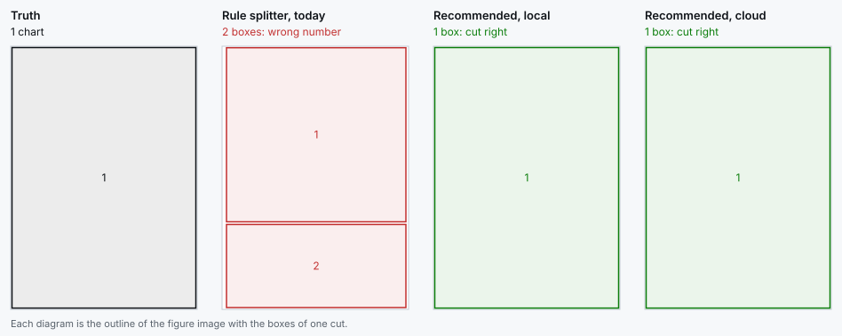
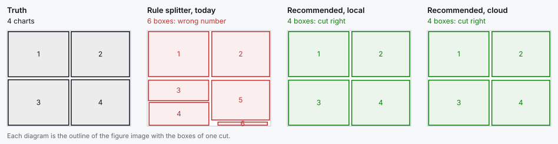
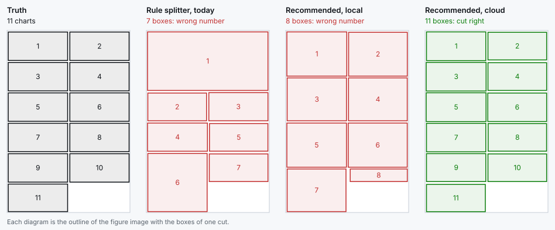

# Three figures, and what each cut makes of them

The problem the split check is about, on three figures of the showcase
paper. They are the only examples shown because that paper is the only one
whose figures are in this repository ([`showcase/`](../../../../../showcase/),
CC BY-NC-ND 4.0, see its `LICENSE`). The figure images below are the
copies already there, unchanged. The diagrams beside them hold no part of
a figure: each is the outline of the image with the boxes of one cut
([`../scripts/make_examples.py`](../scripts/make_examples.py)).

In every diagram: the truth, the rule splitter as it is today, and the
recommended cut with the local model (Gemma 4 26B) and with the cloud
model (Sonnet 5.5).

## Figure 4: one chart that looks like several

37 stacked bars in six blocks of models, all on one x axis: one chart. The
rule splitter finds two runs of tick labels and cuts the figure in two. In
round 4 the values of the second part then counted as invented, because
that part matches no chart.

Both models list one chart. The rules' cut does not have one, so the
figure is left whole.

## Figure 7: four panels cut in six

Four line charts. The rule splitter cuts the two lower ones across their y
axis and finds six. In round 4 the local engine read what it was given:
107 values in six charts, where the figure has 52 in four.

Both models list four charts, and the rules' cutter started from their
boxes gives four whole ones.

## Supplementary Figure S5: a grid the local model miscounts

Eleven stacked-bar panels in two columns. The rule splitter finds seven.
Gemma lists eight, and the cutter started from eight boxes cannot be
right. Sonnet lists eleven and the cut is right.

This is where the two configurations differ: grids of many small charts.

## What no configuration cuts right

Grids of 14 to 18 small charts, all in other papers (W05, W10, W16 of the
set). The cloud models have the number of charts right there, and too many
of their boxes miss their chart. Those figures are not ours to publish;
the private page of the check shows them.
